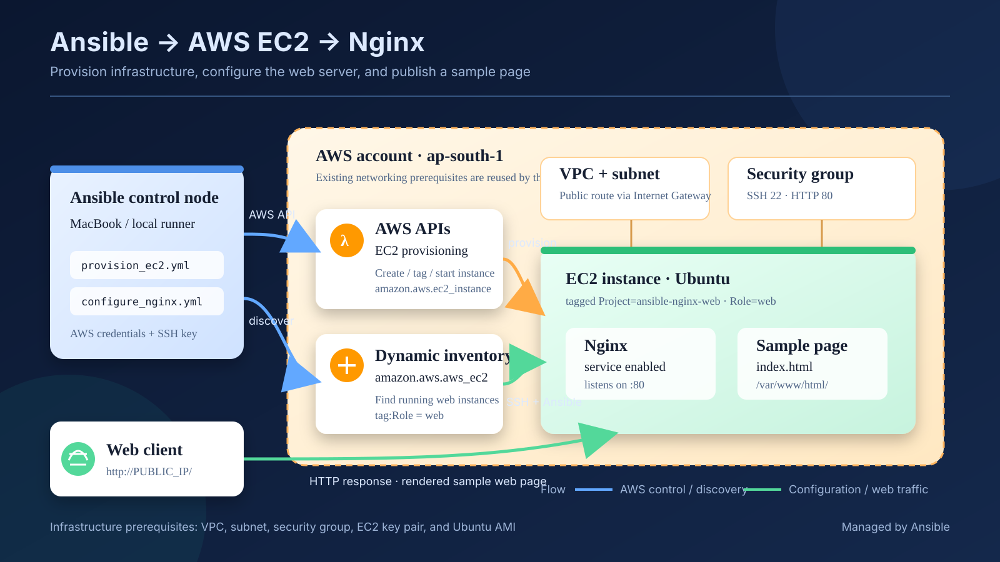

# Enterprise-style Ansible AWS EC2 + Nginx deployment

This lab provisions an Ubuntu EC2 instance in your AWS account, discovers it through the AWS EC2 dynamic inventory plugin, installs Nginx, and deploys a templated HTML page.

## Architecture



```text
MacBook / Ansible Control Node
  |
  | AWS API (IAM profile or environment credentials)
  v
AWS VPC
  ├── Public subnet (provided by you)
  ├── Security group: SSH from your IP; HTTP from allowed clients
  └── EC2 Ubuntu web server (tagged Environment=dev, Role=web)
         ├── Nginx
         └── /var/www/html/index.html
```

This project deliberately does not create a VPC, subnet, or security group automatically. Reuse a lab VPC or create these prerequisites in AWS first, so the playbook cannot accidentally expose an instance or create unexpected networking costs.

## Project layout

```text
ansible-nginx-aws-enterprise/
├── ansible.cfg
├── requirements.yml
├── inventory/
│   └── aws_ec2.yml
├── group_vars/
│   └── all.yml
├── playbooks/
│   ├── provision_ec2.yml
│   └── configure_nginx.yml
├── roles/
│   └── nginx_web/
│       ├── defaults/main.yml
│       ├── handlers/main.yml
│       ├── tasks/main.yml
│       └── templates/index.html.j2
└── README.md
```

## 1. Install prerequisites on your Mac

```bash
brew install ansible
python3 -m pip install --user boto3 botocore
cd ansible-nginx-aws-enterprise
ansible-galaxy collection install -r requirements.yml
```

If your Python installation is externally managed, use a virtual environment instead:

```bash
python3 -m venv .venv
source .venv/bin/activate
python -m pip install ansible boto3 botocore
ansible-galaxy collection install -r requirements.yml
```

When using the virtual environment, run the playbooks after activating it:

```bash
source .venv/bin/activate
ansible-playbook playbooks/provision_ec2.yml
```

Alternatively, use the virtual environment executable directly:

```bash
./.venv/bin/ansible-playbook playbooks/provision_ec2.yml
```

## 2. Configure AWS credentials

Recommended: use a named AWS CLI profile with least-privilege permissions.

```bash
aws configure --profile personal-lab
export AWS_PROFILE=personal-lab
aws sts get-caller-identity
```

The profile must have permission to describe EC2 networking/images/instances and to create, tag, describe, and start/stop/terminate the lab instance. Do not commit credentials to Git.

## 3. Prepare AWS networking

In your selected AWS region, have these ready:
- A VPC and subnet where the instance should launch.
- A security group allowing TCP 22 only from your current public IP (`YOUR_IP/32`).
- TCP 80 from the clients that should view the site. For a public demo this may be `0.0.0.0/0`, but restrict it when possible.
- An EC2 key pair, with its private key available locally and protected (`chmod 400 path/to/key.pem`).
- An Ubuntu Server AMI ID valid in your selected region.

Set `ec2_key_name` to the AWS key-pair name (for example, `dbtest`), not the local private-key filename (`dbtest.pem`). Set `ansible_ssh_private_key_file` to the local `.pem` path.

Do not expose SSH to `0.0.0.0/0`. If the subnet does not auto-assign public IPv4 addresses, the playbook requests a public IP, but routing through an Internet Gateway and subnet route-table configuration are still required.

## 4. Edit configuration

Edit `group_vars/all.yml` and set the region, AMI, subnet, security group, key-pair name, and local private-key path. Example values are placeholders: replace them with IDs from your own AWS account and region.

The AMI must be a current Ubuntu Server image in the chosen region. AMI IDs differ by region and release; never copy an ID from a different region without verifying it.

## 5. Validate configuration and AWS access

```bash
ansible --version
ansible-inventory --graph
aws sts get-caller-identity
```

The dynamic inventory may show no hosts before the EC2 instance is provisioned; that is expected.

## 6. Provision EC2

```bash
ansible-playbook playbooks/provision_ec2.yml
```

The playbook uses `amazon.aws.ec2_instance` and tags the instance with `Project=ansible-nginx-web`, `Environment=dev`, and `Role=web`. It does not configure the operating system yet.

## 7. Verify dynamic inventory

```bash
ansible-inventory --graph
ansible-inventory --list
```

If no host appears, check region/profile, instance state, and the `Environment`/`Role` tags. Dynamic inventory uses the AWS credentials available to the process.

## 8. Test SSH and configure Nginx

```bash
ansible webservers -m ansible.builtin.ping
ansible-playbook playbooks/configure_nginx.yml
```

The project keeps SSH host-key verification enabled. On the first connection to a
new instance, verify its fingerprint from a trusted source (for example, the
EC2 console or your provisioning process), then add the host key to your
controller's `known_hosts`:

```bash
ssh-keyscan -H PUBLIC_IP
```

Replace `PUBLIC_IP` with the instance's public IP. Compare the displayed
fingerprint with a trusted fingerprint for the intended instance. Only after
that verification, append the key:

```bash
ssh-keyscan -H PUBLIC_IP >> ~/.ssh/known_hosts
```

If the instance was replaced and its address was reused, remove the stale entry
first:

```bash
ssh-keygen -R PUBLIC_IP
```

If SSH still fails, verify the key pair, `ansible_user`, security-group source
IP, public IP, and route to an Internet Gateway. Do not disable host-key
verification with `host_key_checking = False` or
`StrictHostKeyChecking=no`.

## 9. Test the website

Get the public IP from AWS Console or run:

```bash
aws ec2 describe-instances \
  --filters "Name=tag:Project,Values=ansible-nginx-web" \
            "Name=tag:Environment,Values=dev" \
            "Name=instance-state-name,Values=running" \
  --query 'Reservations[].Instances[].[InstanceId,PublicIpAddress,State.Name]' \
  --output table
```

Open `http://PUBLIC_IP/`.

## 10. Idempotency and operations

Run the configuration playbook a second time. It should report few or no changes if the server already matches the desired state.

To remove the lab instance, inspect the exact matching instance IDs first, then terminate only the intended lab instance through the AWS Console or a carefully scoped AWS CLI command. This project intentionally has no automatic destroy playbook.

## Production-hardening checklist

- Use IAM roles/SSO or short-lived credentials rather than static access keys.
- Restrict SSH to a trusted CIDR or use AWS Systems Manager Session Manager.
- Restrict HTTP/HTTPS ingress and use TLS for real applications.
- Pin tested Ansible collection versions in a production repository.
- Keep secrets in Ansible Vault or a secrets manager; never commit them.
- Use separate inventories and variable files per environment (`dev`, `staging`, `prod`).
- Add CI checks (`ansible-lint`, syntax checks), change review, and approval before production runs.
- Use immutable images and a load balancer/Auto Scaling Group for highly available workloads.
- Add monitoring, log forwarding, backups, patching policy, and rollback procedures.
- Review AWS costs and clean up lab resources after testing.
